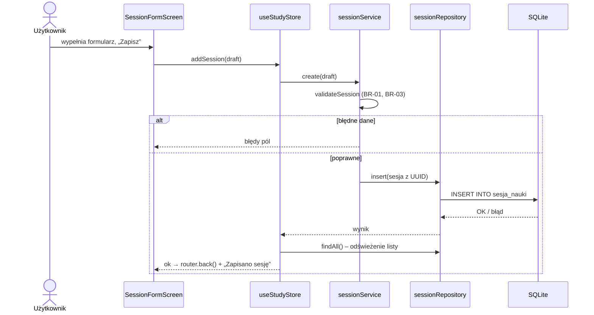
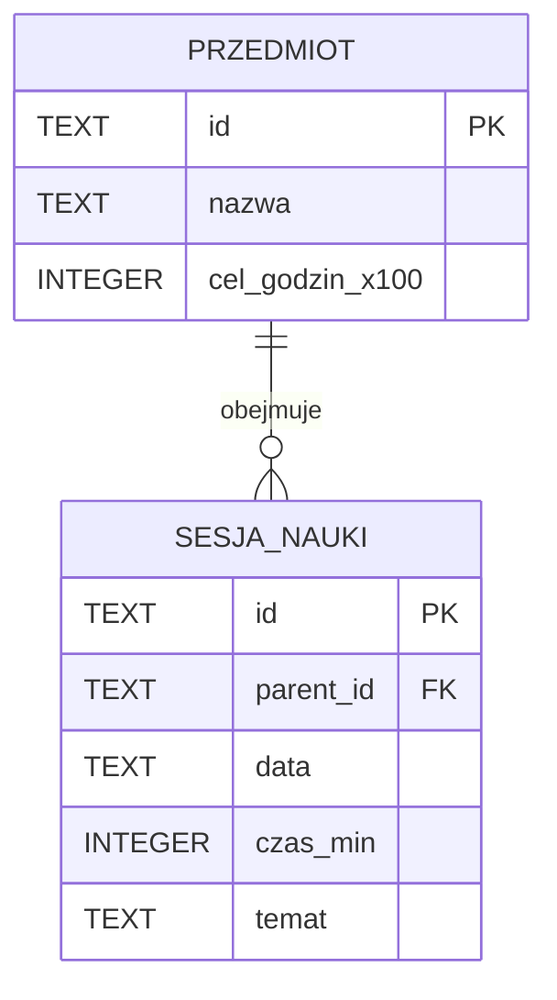

# Laboratorium 2 — sprawozdanie teoretyczne

**Imię i nazwisko: Maciej Masztalerz**  
**Grupa: 43**  
**Data: 07.11.2026**

## Zasady opracowania

1. Odpowiedz samodzielnie, korzystając z materiałów udostępnionych na Moodle oraz dodatkowych źródeł technicznych (np. oficjalnej dokumentacji).
2. Nie ograniczaj odpowiedzi do definicji. Wyjaśniaj własnymi słowami, uzasadniaj wnioski i podawaj przykłady.
3. W zadaniach odnoszących się do projektu użyj **własnego, przydzielonego tematu aplikacji**.
4. Podaj źródła wykorzystane do opracowania odpowiedzi. Sam link bez wskazania, do czego został wykorzystany, nie wystarcza.

## T1. Podejścia do tworzenia aplikacji mobilnych

**Polecenie:** Zbadaj cztery podejścia: natywne, wieloplatformowe, hybrydowe (WebView) i PWA.

**A.** Uzupełnij tabelę. Zwróć uwagę, że „wieloplatformowe” i „hybrydowe” nie muszą oznaczać tego samego.
 
| Kryterium                    | Natywne | Wieloplatformowe | Hybrydowe (WebView) | PWA |
| ---------------------------- | ------- | ---------------- | ------------------- | --- |
| Sposób tworzenia interfejsu  | Osobny kod na platformę (Kotlin + Compose, Swift + SwiftUI) | RN tworzy prawdziwe natywne widoki [1], Flutter rysuje własne widżety | Strona HTML/CSS/JS w WebView osadzonym w natywnej powłoce [2][3] | Aplikacja webowa w przeglądarce, gdzie manifest i service worker pozwalają ją zainstalować [4] |
| Dostęp do funkcji urządzenia | Pełny, bezpośrednio przez SDK | Szeroki, przez moduły (Expo SDK, pub.dev); | Przez pluginy mostka JS [3] | Tylko Web API danej przeglądarki |
| Dystrybucja aplikacji        | Google Play, App Store | Sklepy (Expo Go do testów) | Sklepy (natywny pakiet) | URL, instalacja z przeglądarki, bez sklepu |
| Typowe ograniczenie          | Dwa kody, więc ok. 2× koszt | Zależność od frameworka i bibliotek | Wydajność ograniczona przez WebView | Dane mogą zostać usunięte przez przeglądarkę [6] |
| Przykładowa technologia      | Kotlin + Jetpack Compose + Room [9], Swift + SwiftUI | React Native, Flutter, NativeScript | Ionic + Capacitor, Cordova | React + Vite + Workbox |

**B.** Wybierz dwa podejścia do aplikacji wymagającej działania bez internetu i dostępu do aparatu. Porównaj je, wskazując założenia i ryzyka.

**Odpowiedź:**

Porównuję React Native + Expo** i PWA na przykładzie StudyPlannera.
 
| Kryterium | React Native + Expo | PWA |
| --- | --- | --- |
| Offline | Kod w pakiecie, działa od razu | Dopiero gdy service worker przy pierwszej wizycie online zapisze zasoby w cache [5] |
| Trwałość | Plik SQLite przetrwa restart [8] | Tryb „best effort”; Safari usuwa dane po 7 dniach bez interakcji (poza PWA na ekranie głównym) [6] |
| Aparat | Natywne API przez moduł Expo | `getUserMedia`, a na iOS w trybie standalone długo zawodne [7] |
 
**Ryzyka:** Ryzykiem RN jest zależność od SDK Expo, obsługa odmowy uprawnień, publikacja w sklepach. Ryzykiem PWA jest utrata danych, niepewny aparat na iOS, zachowanie zależne od przeglądarki.
 
**Wniosek:** przy wymaganym offline i aparacie bezpieczniejsze jest RN. PWA pasuje, gdy liczy się dystrybucja przez link, a dane są synchronizowane z serwerem.

**C.** Wskaż źródła, na podstawie których dokonałeś porównania.

**Źródła:**

[1] React Native – Core Components and Native Components, https://reactnative.dev/docs/intro-react-native-components – renderowanie RN.
[2] Ionic Blog – How Capacitor Works, https://ionic.io/blog/how-capacitor-works-2 – WebView i mostek natywny w aplikacji hybrydowej.
[3] Capacitor – dokumentacja, https://capacitorjs.com/docs – podejście „web-first w natywnym kontenerze”, pluginy.
[4] MDN – Progressive web apps, https://developer.mozilla.org/en-US/docs/Web/Progressive_web_apps – definicja PWA, instalowalność.
[5] web.dev – Learn PWA: Service workers, https://web.dev/learn/pwa/service-workers – działanie offline (service worker, cache).
[6] web.dev – Storage for the web, https://web.dev/storage-for-the-web – usuwanie danych przez przeglądarkę, 7-dniowy limit Safari.
[7] WebKit Bugzilla – https://bugs.webkit.org/show_bug.cgi?id=185448 i https://bugs.webkit.org/show_bug.cgi?id=273938 – problemy z aparatem w PWA na iOS.
[9] Android Developers – Room, https://developer.android.com/training/data-storage/room – przykład natywnej trwałości danych.

## T2. Architektura i podział odpowiedzialności

**Polecenie:** Wyjaśnij, dlaczego oddzielenie interfejsu, logiki aplikacji i dostępu do danych jest przydatne w projekcie CRUD.

**A.** Opisz własnymi słowami odpowiedzialność trzech wymienionych obszarów. Podaj po jednym przykładzie operacji, która powinna należeć do każdego z nich.

**Odpowiedź:**

Rozdzielenie odpowiedzialności to podstawowa zasada architektury aplikacji mobilnych: komponenty UI są często niszczone i odtwarzane, więc nie powinny przechowywać danych ani reguł [10].
 
| Warstwa | Odpowiedzialność | Przykład w StudyPlanner |
| --- | --- | --- |
| Interfejs (`app/`, `components/`) | Wyświetla dane, zbiera akcje użytkownika, pokazuje wyniki | Komunikat „Czas sesji musi być większy od 0” pod polem |
| Logika (`domain/`, `services/`) | Reguły i obliczenia jako funkcje TS | `sumStudyHours(sessions, od, do)` |
| Dane (`data/`) | Jedyne miejsce z SQL: schemat, zapytania, mapowanie wierszy | `sessionRepository.findAll(filtry)` → `SELECT … ORDER BY data DESC` |

**B.** Rozważ sytuację: ekran formularza bezpośrednio zapisuje dane do bazy, sprawdza reguły biznesowe i wyświetla komunikaty. Zidentyfikuj **dwa konkretne problemy** takiego rozwiązania i zaproponuj zmianę.

**Odpowiedź:**

1. **Reguł nie da się łatwo przetestować ani użyć ponownie.** Test wymagałby renderowania ekranu z bazą, a ta sama reguła w trybie „dodaj” i „edytuj” łatwo się rozjeżdża.
2. **Integralność zależy od każdego ekranu.** Każdy nowy ekran musi sam pamiętać o sprawdzeniu przedmiotu i blokadzie usuwania
**Zmiana:** ekran przekazuje szkic do serwisu, który waliduje dane czystą funkcją, sprawdza relację i zapisuje przez repozytorium, zwracając `{ ok, errors }`. Ekran tylko wyświetla wynik, a baza dodatkowo pilnuje relacji kluczem obcym.

**C.** Naszkicuj przepływ danych podczas dodawania rekordu w Twojej aplikacji (diagram Mermaid albo opis kolejnych kroków). Nazwij odpowiedzialne komponenty.

**Diagram / opis:**

## T3. Model danych i reguły biznesowe

**Polecenie:** Zaprojektuj model danych na podstawie **własnych wymagań biznesowych**.

**A.** Wskaż co najmniej dwie encje, ich atrybuty (z typami danych) oraz relację. Zaznacz identyfikatory i pola wymagane.

| Encja | Atrybut | Typ | Wymagane? | Uzasadnienie |
| ----- | ------- | --- | --------- | ------------ |
| Przedmiot | `id` (PK) | UUID → `TEXT` | Tak | Karta wymaga lokalnych UUID |
| Przedmiot | `nazwa` | `TEXT` | Tak | 1–100 znaków, wyszukiwanie i sortowanie |
| Przedmiot | `celGodzin` | `INTEGER` | Tak | SQLite nie ma typu DECIMAL [12], liczba całkowita omija błędy floata |
| Sesja nauki | `id` (PK) | UUID → `TEXT` | Tak | Jak wyżej |
| Sesja nauki | `parentId` (FK) | `TEXT REFERENCES przedmiot ON DELETE RESTRICT` | Tak | sesja wymaga istniejącego przedmiotu, blokada usuwania [13] |
| Sesja nauki | `data` | `TEXT` `YYYY-MM-DD` | Tak | SQLite nie ma typu daty [12] |
| Sesja nauki | `czasMin` | `INTEGER CHECK > 0` | Tak | BR-01 |
| Sesja nauki | `temat` | `TEXT` | Tak | BR-03, pole do wyszukiwania (FR-05) |
 
Relacja 1:N. SQLite domyślnie nie wymusza kluczy obcych, więc po otwarciu bazy wykonuję `PRAGMA foreign_keys = ON;` [13].
**B.** Przedstaw diagram relacji encji (np. Mermaid `erDiagram`) albo własny czytelny schemat.

**Diagram:**

**C.** Opisz **dwie reguły biznesowe** specyficzne dla Twojego projektu. Dla każdej podaj przypadek poprawny i niepoprawny.

**Odpowiedź:**

**BR-01 – czas sesji dodatni** (liczba całkowita, 1–1440 min).
- Poprawny: „Analiza matematyczna”, 05.11.2026, 90 min, jest zapisane.
- Niepoprawny: `0`, `-15` lub `30.5` zapis jest zablokowany z komunikatem. Ta reguła dostanie test pozytywny i negatywny (TEST-02).
**BR-02 – suma godzin przedmiotu w okresie** (suma `czasMin` sesji z `od ≤ data ≤ do`, ÷ 60, 2 miejsca po przecinku).
- Poprawny: sesje 02.11 (90 min), 05.11 (45 min), 20.11 (60 min); okres 01–15.11 to 2,25 h (sesja z 20.11 pominięta).
- Niepoprawny: okres `od = 15.11`, `do = 01.11` wychodzi komunikat „Data początkowa nie może być późniejsza niż końcowa”.

## T4. Nawigacja i zarządzanie stanem

**Polecenie:** Zaplanuj sposób przechodzenia między ekranami oraz przepływ informacji w aplikacji.

**A.** Zidentyfikuj co najmniej trzy ekrany własnej aplikacji. Dla każdego określ jego cel, dane wejściowe i możliwe akcje użytkownika.

Nawigacja stosowa Expo Router [14].
 
| Ekran | Cel | Dane wejściowe | Akcje użytkownika |
| ----- | --- | -------------- | ----------------- |
| Lista sesji (`/`) | Przegląd sesji | Sesje + filtry (temat, przedmiot, daty) i sortowanie | Szukaj, filtruj, sortuj, otwórz szczegóły, dodaj |
| Szczegóły sesji (`/session/[id]`) | Dane jednej sesji | `id` | Edytuj, usuń (z potwierdzeniem) |
| Formularz sesji (`/session/form`) | Dodanie/edycja | Pusty szkic lub rekord | Wypełnij, zapisz, anuluj |
| Szczegóły przedmiotu (`/subjects/[id]`) | Dane i suma godzin (BR-02) | `id`, okres `[od, do]` | Zmień okres, edytuj, spróbuj usunąć |
 
**B.** Wyjaśnij różnicę między stanem lokalnym formularza a danymi utrwalonymi. Opisz, co powinno się wydarzyć po zapisaniu nowego rekordu i powrocie do listy.

**Odpowiedź:**

Stan lokalny formularza to tymczasowy szkic (`useState`). Widzi go tylko formularz i znika po wyjściu. Dane utrwalone to zwalidowane rekordy w SQLite, które przetrwają restart [8]. Ekrany czytają je przez wspólny store (Zustand – store jako hook, przerenderowanie tylko przy zmianie wybranego stanu [15]).
 
Serwis zapisuje rekord, dopiero po sukcesie store odświeża listę z bazy a formularz czyści szkic, wraca (`router.back()`) i pokazuje „Zapisano sesję”. Lista sama pokazuje nowy rekord. Przy błędzie użytkownik zostaje w formularzu z danymi.

**C.** Wskaż jeden problem wynikający z niespójności stanu między ekranami i zaproponuj sposób jego uniknięcia.

**Odpowiedź:**

**Problem:** po edycji sesji i powrocie ekran przedmiotu pokazuje starą sumę godzin, bo był zamontowany na stosie i nie pobrał danych ponownie.
 
**Rozwiązanie:** jedno źródło prawdy [10] – baza i jeden store. Każda mutacja idzie przez akcję store’a, która odświeża dane, a suma jest liczona przy renderowaniu, nie przechowywana. Ekrany pobierające dane same używają `useFocusEffect` [16].

## T5. Trwałość danych, walidacja i błędy

**Polecenie:** Zbadaj konsekwencje wyboru mechanizmu przechowywania danych i zaplanuj obsługę sytuacji niepoprawnych.

**A.** Porównaj przechowywanie danych wyłącznie w pamięci aplikacji z lokalną trwałą bazą danych. Kiedy dane zostaną utracone? Które podejście spełnia wymagania Twojego projektu?

**Odpowiedź:**

Dane w pamięci giną przy każdym zakończeniu procesu: zamknięciu aplikacji, zamknięciu jej w tle przez system, crashu czy restarcie telefonu. Dane w SQLite giną dopiero po odinstalowaniu aplikacji lub wyczyszczeniu jej danych [8]. Baza daje też relacje, `CHECK` i zapytania SQL (filtrowanie, sortowanie, `SUM`). Wymagania (TECH-04, FUNC-08, FR-11) spełnia tylko baza, więc wybieram **expo-sqlite**.

**B.** Wskaż trzy przypadki walidacji wynikające z wymagań Twojej aplikacji. Dla każdego określ warunek oraz komunikat dla użytkownika.

| Pole / operacja | Warunek poprawności | Przykład błędnych danych | Komunikat |
| --------------- | ------------------- | ------------------------ | --------- |
| `czasMin` (BR-01) | Liczba całkowita 1–1440 | `0`, `-30`, `45.5` | „Czas sesji musi być dodatnią liczbą całkowitą minut.” |
| `temat` / `nazwa` (BR-03) | Niepuste po obcięciu spacji | `""`, `"   "` | „Podaj temat sesji.” / „Nazwa przedmiotu nie może być pusta.” |
| Usunięcie przedmiotu (BR-04) | Brak powiązanych sesji | Przedmiot z 3 sesjami | „Nie można usunąć przedmiotu, ponieważ ma 3 sesje nauki.” |

**C.** Opisz zachowanie aplikacji w dwóch sytuacjach: (1) lista nie zawiera rekordów; (2) zapis danych kończy się błędem. Wyjaśnij, co użytkownik powinien zobaczyć i dlaczego.

**Odpowiedź:**

**(1) Pusta lista:** komunikat z jedną akcją zamiast pustego ekranu, który wygląda jak błąd. Brak przedmiotów skutkuje komunikatem: „Dodaj pierwszy przedmiot” (bez przedmiotu nie da się dodać sesji). Brak sesji skutkuje komunikatem: „Dodaj pierwszą sesję”. Filtr nic nie zwraca: komunikat „Brak wyników” + „Wyczyść filtry”, żeby użytkownik nie myślał, że dane zniknęły.
 
**(2) Błąd zapisu:** serwis łapie wyjątek i zwraca komunikat. Użytkownik zostaje w formularzu z danymi i widzi „Nie udało się zapisać sesji. Spróbuj ponownie.” Nie jest pokazane „Zapisano” i nie dodaje się rekordu do listy. Najgorsze byłoby potwierdzenie zapisu, którego nie ma.

## Wnioski końcowe

1. Która decyzja architektoniczna w Twoim projekcie jest obecnie najważniejsza i dlaczego?
2. Jaką kwestię musisz jeszcze zweryfikować przed dalszą implementacją?

**Wnioski:**
 
1. Najważniejsza jest **warstwa danych**: SQLite z kluczem obcym `RESTRICT` za repozytoriami i reguły w czystych funkcjach. Opierają się na niej CRUD, relacje, wyszukiwanie, suma godzin i trwałość, a jej późniejsza zmiana oznaczałaby przepisanie większości aplikacji.
2. Muszę sprawdzić, jak testować w Jest kod korzystający z expo-sqlite. Uzgodnię definicję „okresu” w BR-02 i zapis `celGodzin` jako liczby całkowitej.

## Bibliografia / wykorzystane źródła

Dla każdego źródła podaj tytuł, adres lub identyfikator, datę dostępu (dla źródeł internetowych) oraz zadanie, w którym je wykorzystano.

1.Data dostępu dla wszystkich źródeł internetowych: 07.11.2026.
 
1. React Native – *Core Components and Native Components*, https://reactnative.dev/docs/intro-react-native-components – T1A (renderowanie RN).
2. Ionic Blog – *How Capacitor Works*, https://ionic.io/blog/how-capacitor-works-2 – T1A (WebView, mostek natywny).
3. Capacitor – dokumentacja, https://capacitorjs.com/docs – T1A (podejście hybrydowe, pluginy).
4. MDN – *Progressive web apps*, https://developer.mozilla.org/en-US/docs/Web/Progressive_web_apps – T1A (definicja PWA).
5. web.dev – *Learn PWA: Service workers*, https://web.dev/learn/pwa/service-workers – T1B (offline).
6. web.dev – *Storage for the web*, https://web.dev/storage-for-the-web – T1A, T1B (usuwanie danych, limit Safari).
7. WebKit Bugzilla https://bugs.webkit.org/show_bug.cgi?id=185448, https://bugs.webkit.org/show_bug.cgi?id=273938 – T1B (aparat w PWA na iOS).
8. Expo – *SQLite*, https://docs.expo.dev/versions/latest/sdk/sqlite/ – T1B, T4B, T5A (trwałość danych).
9. Android Developers – *Room*, https://developer.android.com/training/data-storage/room – T1A (natywna trwałość).
10. Android Developers – *Guide to app architecture*, https://developer.android.com/topic/architecture – T2A, T4C (warstwy, single source of truth).
11. Karta MOB-016 i *Wymagania wspólne projektu* (materiały przedmiotu) – T2–T5.
12. SQLite – *Datatypes In SQLite*, https://www.sqlite.org/datatype3.html – T3A (typy, brak DECIMAL i daty).
13. SQLite – *Foreign Key Support*, https://sqlite.org/foreignkeys.html – T3A (`RESTRICT`, `PRAGMA foreign_keys`).
14. Expo Router – *Stack*, https://docs.expo.dev/router/advanced/stack – T4A (nawigacja stosowa).
15. Zustand – *Introduction*, https://zustand.docs.pmnd.rs/learn/getting-started/introduction – T4B (store).
16. Expo Router – *Handle screen focus*, https://docs.expo.dev/router/reference/focus-handling/ – T4C (`useFocusEffect`).

Ocena uwzględnia poprawność merytoryczną, kompletność, uzasadnienie decyzji, odniesienie do własnego projektu oraz jakość dokumentacji. Samo przepisanie definicji bez analizy nie jest wystarczające.

Disclaimer AI: Wykorzystano Claude model OPUS 5.5 do znalezeinia źródeł, przypisania ich do zadań poleceń i do stworzenia diagramów mermaid.